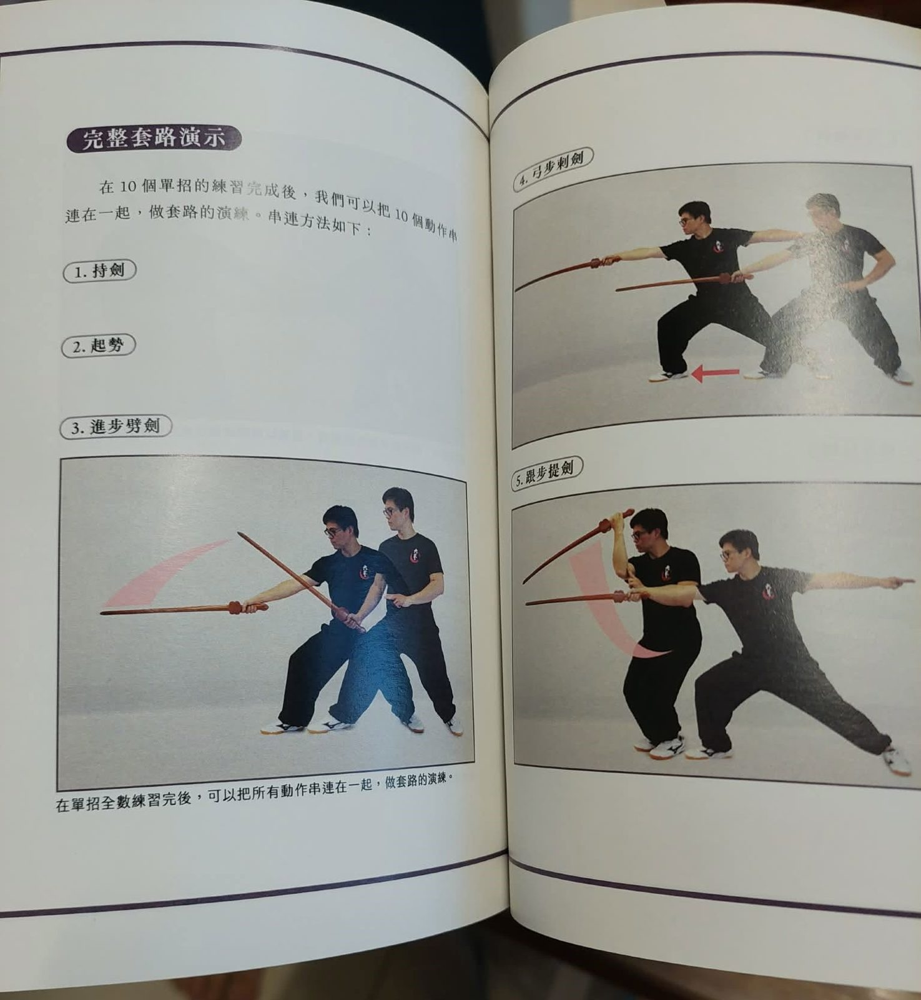

手裡多了一件兵器，距離變了，出手的方式也跟著變。

劍術的學習，不只是記住招式，而是在一次次練習中，逐漸掌握身體、步伐與器械之間的配合。從基本動作、身法步伐，到招式的連貫與應用，看似重複的日常訓練，都在為下一步打基礎。

我們希望讓傳統兵器不只是展示與欣賞，而是透過有系統的訓練，真正成為可以學習、練習與運用的技藝。沒有武術基礎也沒關係，課程從基礎開始，循序漸進。

## 上課時間

- 週五 18:00–19:30：苗刀
- 週六 17:30–19:00：大槍
- 週日 16:00–17:30：中國劍新班（2026 年 11 月起招生）
- 週日原有的 18:00–19:30 時段是否照常，請用 LINE 確認

## 延伸閱讀：《十字劍訣述真》

「十字劍訣」相傳為李書文整理昆吾劍後研擬的基本動作訓練法，把繁複的劍術攻防歸納為十個核心技法。這本書由總教練詹前賢老師與王人俊合著，整理詹老師多年練習、教學與實作的經驗，談技法之間的關係，以及中線、拍位、步法與戰術變化如何落實到訓練與應用。

預購請洽官方 LINE（粉專公告預購至 2026 年 11 月 30 日）。
