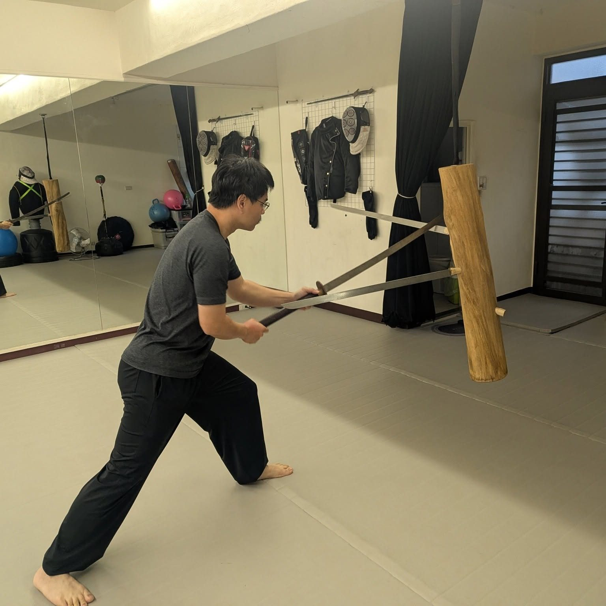

手裡多了一件兵器，距離變了，出手的方式也跟著變。

劍術的學習，不只是記住招式，而是在一次次練習中，逐漸掌握身體、步伐與器械之間的配合。從基本動作、身法步伐，到招式的連貫與應用，看似重複的日常訓練，都在為下一步打基礎。

我們希望讓傳統兵器不只是展示與欣賞，而是透過有系統的訓練，真正成為可以學習、練習與運用的技藝。沒有武術基礎也沒關係，課程從基礎開始，循序漸進。

## 上課時間

2026 年 11 月公告：

- 週日 16:00–17:30：中式劍新班，招生中
- 週六 17:30–19:00：目前進度為大槍
- 週五 18:00–19:30：目前進度為苗刀

## 延伸閱讀：《十字劍訣述真》

「十字劍訣」相傳為李書文整理昆吾劍後所研擬的基本動作訓練法，將繁複的劍術攻防歸納為十個核心技法。本書是總教練詹前賢老師多年練習、教學與實作經驗的整理（書封作者：詹前賢、王人俊），談技法之間的關係，以及如何結合中線、拍位、步法與戰術變化，落實在訓練與應用之中。

預購至 2026 年 11 月 30 日，請填[訂購表單](https://forms.gle/DrSsSAWKb6FRkMdv5)或洽官方 LINE。
